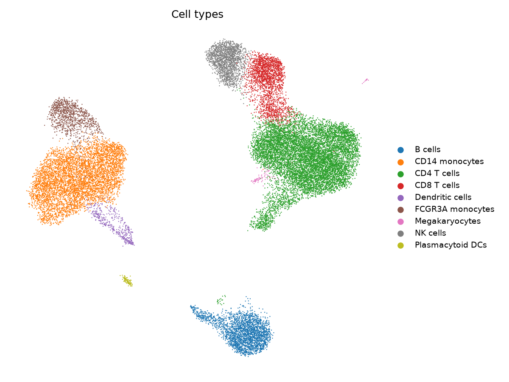
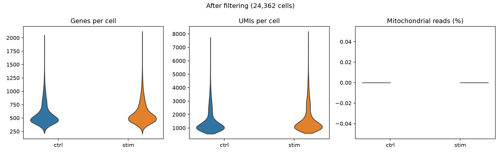
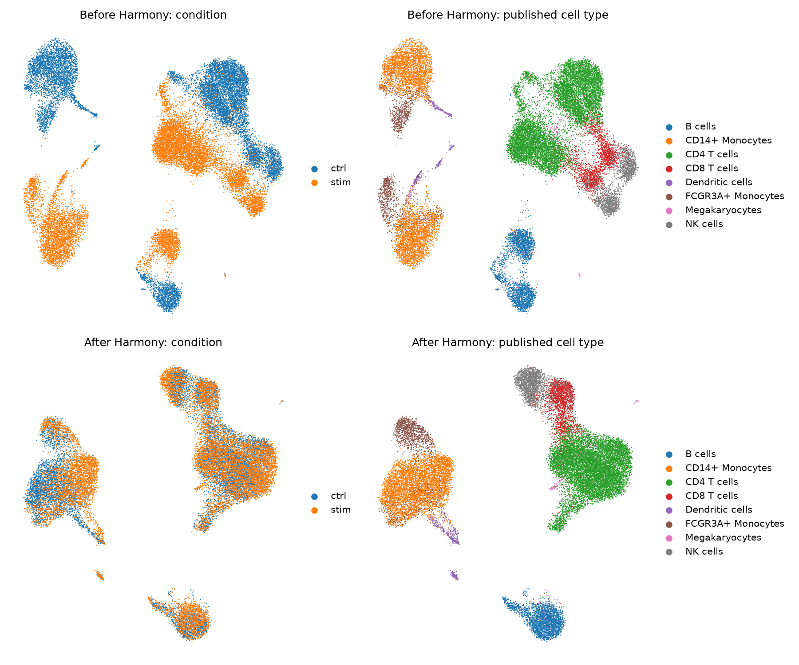
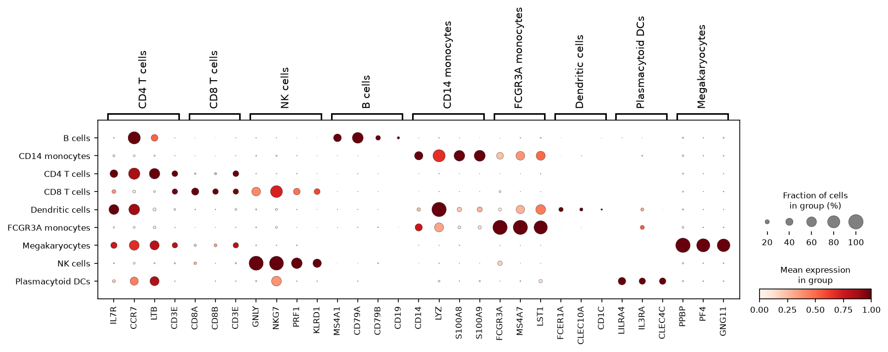
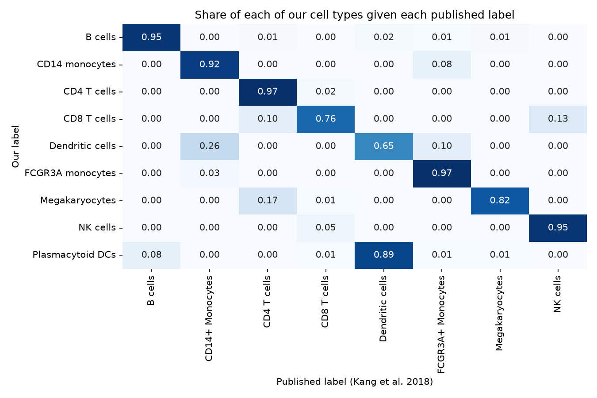
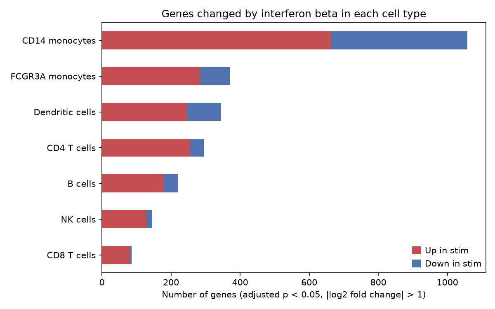
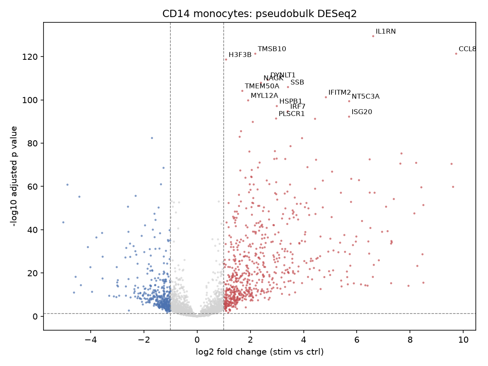
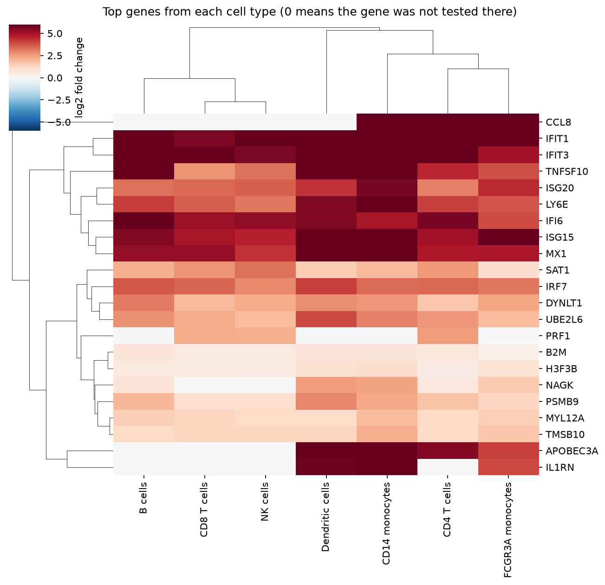
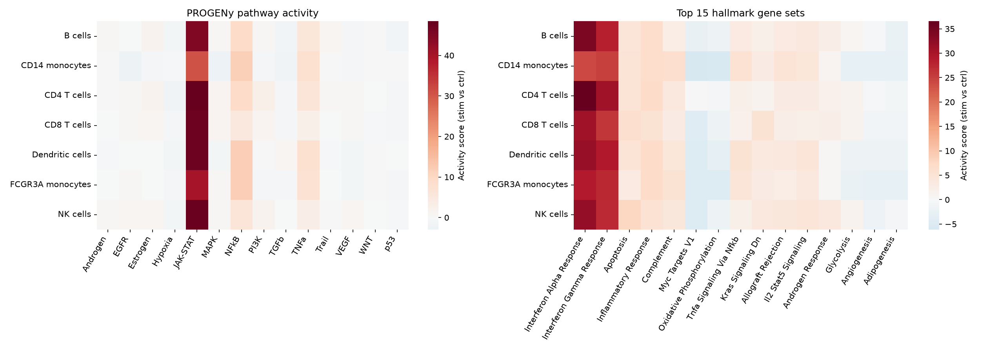
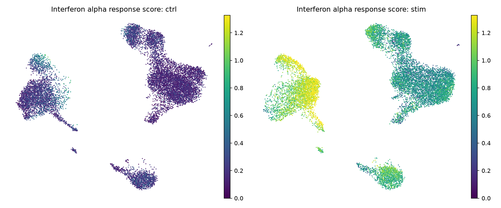

# Single cell RNA seq: how immune cells respond to interferon beta

This project is a full single cell RNA seq analysis of human blood immune cells (PBMCs), from raw count matrices all the way to cell type specific differential expression and pathway analysis. It uses public data, runs with one command, and every step is explained in plain words so that you can follow it, rerun it, or reuse it for your own data.

**Question:** When immune cells are exposed to interferon beta, which cell types respond, which genes change, and how strong is the response in each cell type?



## The data

Kang et al. 2018, *Nature Biotechnology*. GEO accession [GSE96583](https://www.ncbi.nlm.nih.gov/geo/query/acc.cgi?acc=GSE96583), batch 2.

PBMCs from 8 healthy donors were split into two halves. One half was left alone (**ctrl**). The other half was treated with interferon beta for 6 hours (**stim**). Cells from all 8 donors were pooled and run on 10x Chromium. The authors then used the natural genetic differences between people (with a tool called demuxlet) to work out which donor each cell came from. That trick also flags droplets that hold cells from two different donors.

| | Control | Stimulated |
|---|---|---|
| Cells in the GEO files | 14,619 | 14,446 |
| Donors | 8 | 8 |

The pipeline downloads everything it needs from GEO. Nothing has to be fetched by hand.

## What the pipeline does

| Step | Script | What happens |
|---|---|---|
| 1 | `01_load.py` | Read the two count matrices, join them, and attach donor and doublet calls from the authors |
| 2 | `02_qc.py` | Remove poor quality cells and doublets |
| 3 | `03_integrate.py` | Normalize, find variable genes, run PCA, and line up the two conditions with Harmony |
| 4 | `04_annotate.py` | Cluster with Leiden, name clusters from marker genes, and check against the published labels |
| 5 | `05_pseudobulk_de.py` | Add up counts per donor and cell type, then run DESeq2 (PyDESeq2) for stim vs ctrl |
| 6 | `06_pathways.py` | Score pathways (PROGENy) and hallmark gene sets (MSigDB) for every cell type |

All steps are joined together with Snakemake, so it knows what to rerun when something changes.

## Results

### 1. Quality control

Cells were kept if they had between 200 and 2,500 genes and less than 5% mitochondrial reads. Doublets were removed in two ways. Demuxlet catches droplets with cells from two donors. Scrublet looks at expression alone, so it also catches droplets with two cells from the same donor.

| Step | Cells left |
|---|---|
| Starting cells | 29,065 |
| After gene count and mitochondrial filters | 28,869 |
| After removing demuxlet doublets and unclear cells | 24,560 |
| After removing Scrublet doublets | 24,362 |



### 2. Integration

Interferon changes the expression of hundreds of genes in every cell. Without any correction, treated and control cells of the same type end up far apart on the UMAP (top row). After Harmony, cells group by what they are and not by how they were treated (bottom row). Monocytes still show a little split by condition. This makes sense, since they have the strongest response of all.



Harmony is only used to build the UMAP and the clusters. The differential expression further down uses the raw counts, so the real treatment effect is not removed.

### 3. Cell type annotation

Leiden found 13 clusters. Each cluster was named by scoring cells for well known PBMC marker genes and picking the cell type whose markers stand out most in that cluster.



To check the labels, we compared them with the cell types published by the original authors. Most cell types match very well (B cells 95%, CD4 T cells 97%, FCGR3A monocytes 97%, NK cells 95%). The authors grouped all dendritic cells together, while we split them into conventional and plasmacytoid dendritic cells.



| Cell type | Control | Stimulated |
|---|---|---|
| CD4 T cells | 5,172 | 5,225 |
| CD14 monocytes | 2,819 | 2,774 |
| B cells | 1,294 | 1,348 |
| CD8 T cells | 1,111 | 1,160 |
| NK cells | 849 | 895 |
| FCGR3A monocytes | 512 | 566 |
| Dendritic cells | 233 | 197 |
| Plasmacytoid DCs | 39 | 68 |
| Megakaryocytes | 35 | 65 |

### 4. Differential expression with pseudobulk

A common mistake in single cell work is to test thousands of single cells as if each one were an independent sample. Cells from the same person are not independent, so this gives a flood of false positives. Here we add up the raw counts of all cells from the same donor, condition and cell type. Each of these sums is called a pseudobulk sample. Then we use DESeq2 with donor in the model, so every donor is compared with themselves.

Megakaryocytes and plasmacytoid DCs were skipped, because too few donors had at least 10 of these cells in both conditions.



| Cell type | Up in stim | Down in stim | Total |
|---|---|---|---|
| CD14 monocytes | 664 | 394 | 1,058 |
| FCGR3A monocytes | 285 | 85 | 370 |
| Dendritic cells | 247 | 98 | 345 |
| CD4 T cells | 256 | 39 | 295 |
| B cells | 179 | 42 | 221 |
| NK cells | 130 | 16 | 146 |
| CD8 T cells | 81 | 5 | 86 |

Cutoffs: adjusted p value below 0.05 and a fold change of more than 2 in either direction.

Monocytes respond the most. Their top genes include IL1RN, CCL8 and IFITM2. CCL8 alone goes up about 850 times.



Classic interferon stimulated genes such as ISG15, IFIT1, IFIT3, MX1 and IFI6 go up in every cell type. Some genes respond in only a few cell types. IL1RN, for example, goes up only in monocytes and dendritic cells.



### 5. Pathways

JAK and STAT signalling is the pathway interferon beta uses to send its signal into the cell. PROGENy picks it up as by far the most active pathway in every cell type. The two interferon hallmark gene sets are the top hits in every cell type too. This is a good sanity check that the whole pipeline is working.



Scoring each single cell for the hallmark interferon alpha response genes shows the same thing on the UMAP. The score is low in control cells and high across all stimulated cells. It is highest in monocytes.



## How to run it

You need [conda](https://docs.conda.io) or [mamba](https://mamba.readthedocs.io) and an internet connection. The whole run takes about 10 minutes on a laptop with 16 GB of memory.

```bash
git clone https://github.com/hafizmtalha/scrnaseq-ifnb-pbmc.git
cd scrnaseq-ifnb-pbmc

# Create the software environment (one time only)
mamba env create -f environment.yml
conda activate scrnaseq-ifnb-pbmc

# Run everything
snakemake --cores 4
```

To see the steps without running them:

```bash
snakemake --cores 4 --dry-run
```

All outputs go into `results/`. Each step writes a log into `logs/`.

## Folder layout

```
scrnaseq-ifnb-pbmc/
├── config/config.yaml        settings: data links, QC cutoffs, clustering options
├── environment.yml           all software with versions
├── workflow/
│   ├── Snakefile             joins the steps together
│   └── scripts/              one Python script per step
├── docs/figures/             figures shown in this README
├── data/                     downloaded files (made by the pipeline)
├── results/
│   ├── adata/                AnnData objects after each step
│   ├── figures/
│   ├── tables/               QC summary, cluster markers, cell counts
│   └── de/                   DE results for every cell type, pathway scores
└── logs/
```

## Changing the settings

Everything you might want to change is in `config/config.yaml`.

| Setting | Default | What it does |
|---|---|---|
| `min_genes`, `max_genes` | 200, 2500 | Range of genes a cell must have |
| `max_pct_mito` | 5 | Highest share of mitochondrial reads allowed |
| `n_top_genes` | 2000 | Number of variable genes used for PCA |
| `n_pcs` | 30 | Number of principal components used |
| `leiden_resolution` | 1.0 | Higher numbers give more, smaller clusters |
| `min_cells_pseudobulk` | 10 | Fewest cells needed to build a pseudobulk sample |

## Using it with your own data

1. Swap the loading step (`01_load.py`) for one that reads your files. For Cell Ranger output this is just `sc.read_10x_h5`. Make sure every cell has a `donor`, a `condition` and a `sample` column.
2. Change the marker lists in `04_annotate.py` if you are not working with blood.
3. If your conditions come from different people (not the same donor twice), change the design in `05_pseudobulk_de.py` from `~donor + condition` to `~condition`.

## A few notes on the choices made

* **Why pseudobulk and not a test on single cells?** Benchmarks such as Squair et al. 2021 show that methods that treat cells as replicates find many false positives. Pseudobulk methods do much better.
* **Why integrate on condition?** Here the same donors appear in both conditions, so the main thing pulling cells apart is the treatment. We want cell types to line up across conditions so that one set of labels works for both.
* **Why marker scoring and not an automatic tool?** It is easy to see and check. The scores for each cluster are saved as a figure (`marker_scores_by_cluster.png`), so anyone can see why a cluster got its name.

## Software

Scanpy, AnnData, Harmony, Scrublet (inside Scanpy), PyDESeq2, decoupler, Snakemake. Exact versions are pinned in `environment.yml`.

## References

* Kang HM et al. Multiplexed droplet single cell RNA sequencing using natural genetic variation. *Nature Biotechnology* 36, 89 to 94 (2018).
* Wolf FA, Angerer P, Theis FJ. SCANPY: large scale single cell gene expression data analysis. *Genome Biology* 19, 15 (2018).
* Korsunsky I et al. Fast, sensitive and accurate integration of single cell data with Harmony. *Nature Methods* 16, 1289 to 1296 (2019).
* Muzellec B et al. PyDESeq2: a python package for bulk RNA seq differential expression analysis. *Bioinformatics* 39, btad547 (2023).
* Badia i Mompel P et al. decoupleR: ensemble of computational methods to infer biological activities from omics data. *Bioinformatics Advances* 2, vbac016 (2022).
* Squair JW et al. Confronting false discoveries in single cell differential expression. *Nature Communications* 12, 5692 (2021).

## License

MIT. See [LICENSE](LICENSE).
